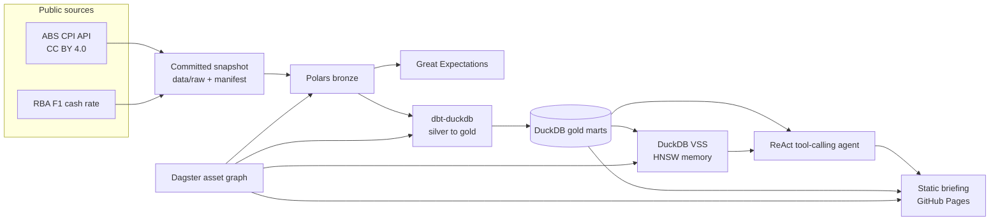

# grocery-shock-agent

[](https://github.com/LuciferDataEngineer/grocery-shock-agent/actions/workflows/ci.yml)
[](https://luciferdataengineer.github.io/grocery-shock-agent/)

**Live briefing:** https://luciferdataengineer.github.io/grocery-shock-agent/

Daily portfolio project **#8** for [LuciferDataEngineer](https://github.com/LuciferDataEngineer).

After the Reserve Bank cash-rate target reached **4.85% on 4 November 2026**, and headline consumer prices rose **4.3%** in the year to September 2026, where is the Australian grocery basket actually hurting, what can a household swap, and what should policymakers watch next?

The short answer, from the published figures only:

- The food group is **up 3.2%**, slower than overall prices. The aisle is not the main national driver.
- The shelf is uneven. **Fruit is up 10.2%** (it was 1.8% in August). **Breakfast cereals are up 8.5%**. **Beef is up 5.8%**, down from 12.6% in July. **Eggs are down 2.3%** and **pork is down 1.3%**.
- **Petrol is up 23.6%** and added 0.77 points to the national rise. Housing added 1.14 points. The food group added 0.56.
- The cash rate was raised **five times in 2026**, from 3.60% to 4.85%. Mortgage repayments are not inside the grocery prices.

A supermarket basket weighted like the national basket was up **3.0%**. Moving half of the beef weight and half of the fruit weight onto eggs and pork trims that to **2.2%** (0.8 percentage points).

## Architecture



The stakeholder site never names this stack. The engineering lives here and in `INSIGHTS.md`.

## Tech stack, and why

| Piece | Choice | Why |
| --- | --- | --- |
| Warehouse | DuckDB | One file, fast SQL, no paid warehouse. Gold marts are the only place the agent is allowed to read numbers. |
| Bronze | Polars | Columnar clean of the ABS extracts: types, nulls, uniqueness, parquet. Clear step up from doing that clean in SQL. |
| Silver and gold | dbt-duckdb | Tested SQL models: index path, published yearly change, contribution, weights, cash-rate decisions. |
| Orchestration | Dagster | Asset graph for bronze, expectations, gold, the vector index, and the site. The Makefile calls the same functions. |
| Data quality | Great Expectations 1.5 | Ephemeral suites on the bronze frames: nulls, ranges, uniqueness, allowed measures. dbt tests guard the marts, including a reconciliation of the published yearly change against the index. |
| Agent | Deterministic ReAct loop | Tool registry, planner, executor, grounded renderer, JSON traces. See the honesty note below. |
| Retrieval | DuckDB VSS HNSW | Insight notes are embedded and indexed with a cosine HNSW index. The agent retrieves notes; it does not invent them. |
| Embeddings | Signed feature hashing, 128 dimensions | Local and deterministic. No model download, no paid embedding API. |
| Tests | pytest + ruff | Transforms, read-only SQL, a happy-path question, and an eval with tool-call and recall checks. |
| Briefing | Static HTML + ECharts | GitHub Pages, no backend. Five questions are baked from committed traces. |
| CI | GitHub Actions | Install, lint, tests, and a Pages deploy from `main`. |

No AWS, GCP, Azure, Snowflake, Databricks, Supabase, OpenAI, or Anthropic.

### Why there is no hosted or local LLM

A small local model would make CI slow and flaky, and a hosted model would need a paid key. This project still implements a real tool-calling loop:

1. A **tool registry** with schemas and functions (`query_gold_sql`, `get_kpi_snapshot`, `rank_categories`, `substitution_hints`, `retrieve_insights`, `what_if_basket`).
2. A **planner** that chooses the next tool from the question and from tools already called.
3. An **executor** that runs the tool and stores the observation.
4. A **renderer** that may only quote fields returned by those tools.
5. A **trace** of thought, action, observation, and final answer.

The planner is deterministic on purpose. Swap it for a local open model later without changing the tools. Until then, every percentage in an answer can be traced to a query.

Retrieval is also honest about its limits. Feature hashing matches shared words. It is not MiniLM. The HNSW index is real DuckDB VSS; the vectors are not neural.

## What's new versus project #7

Project **#7, ai-grid-pressure**, used Iceberg merge-on-read, Trino, OpenLineage and Marquez, Great Expectations, dbt-duckdb, Dagster, DuckDB gold, and AEMO plus the ABS electricity CPI.

This project keeps DuckDB, dbt-duckdb, Dagster, and Great Expectations, and steps up in three ways those pieces did not cover:

1. **A tool-calling agent is the product.** Stakeholders ask a question. The agent must call tools. It cannot invent a percentage. Traces are committed and checked.
2. **DuckDB VSS (HNSW)** is the agent's memory. Insight notes are chunked, embedded, and searched with a cosine HNSW index.
3. **Polars owns bronze.** The ABS monthly CPI extract is typed, deduplicated, and written to parquet before dbt sees it.

The subject is also wider than electricity CPI: the food basket and its shelf lines, transport, housing, petrol, and the RBA cash-rate path.

## Data sources

All of this is free. The snapshot was taken on **6 November 2026**. If a refresh fails, `make ingest` keeps the committed files. Nothing in `data/raw` was typed by hand.

| Dataset | Publisher | URL | Licence | Coverage | Free |
| --- | --- | --- | --- | --- | --- |
| CPI monthly index, yearly change, and yearly contribution | Australian Bureau of Statistics | [ABS Data API, `ABS,CPI,2.0.0`](https://data.api.abs.gov.au/rest/data/ABS,CPI,2.0.0/) | CC BY 4.0 | Australia, original, monthly. Index from 2023-09. Yearly change from 2024-09. Contribution from 2025-09. Latest month **2026-09**. Key pattern `{measure}.{index}.10.50.M`. | yes |
| CPI weights | Australian Bureau of Statistics | [`ABS,CPI_WEIGHTS,1.0.0`](https://data.api.abs.gov.au/rest/data/ABS,CPI_WEIGHTS,1.0.0/) | CC BY 4.0 | Eight-capitals basket weights, 2018-Q3 through **2024-Q4**. Each series is requested on its own. A combined key returns only one quarter. | yes |
| F1 cash rate target and overnight cash rate | Reserve Bank of Australia | [f1-data.csv](https://www.rba.gov.au/statistics/tables/csv/f1-data.csv) | Free RBA table. Attribute the Bank. Not Creative Commons. | Daily target, published change, and overnight rate, 2024-01-02 through 2026-11-05. | yes |

The manifest is `data/manifest.json`.

Measures used from the CPI API:

- `1` index numbers
- `3` percentage change from the previous year (the figure the briefing quotes)
- `7` contribution to the annual percentage-point change

The month-to-month move on the shop chart is calculated from the published index. The dbt test `yoy_matches_index` fails the build if the published yearly change and the index-based change differ by more than 0.15, which is rounding room.

### Cash-rate note

On **30 September 2026** the target moves from 4.35 to 4.60 and the overnight rate prints 4.60, but the published change column is blank. The pipeline keeps the blank and still counts the step, because the level changed. The five 2026 rises are 4 February, 18 March, 6 May, 30 September, and 4 November. Each step in the target is +0.25, from 3.60% to 4.85%.

The 6 November 2026 target cell was empty in the RBA file on the access day, so the extract stops at 5 November.

## Cleaning and the data model

1. **Ingest.** Download, or read the snapshot. Weights are fetched one series at a time because the combined SDMX key drops history.
2. **Bronze (Polars).** Force string ids, drop null values, check period shapes, dedupe, write parquet.
3. **Expectations.** Non-null values, measure codes in `{1, 3, 7}`, index levels between 40 and 300, changes between -80 and 80, weights between 0 and 100, unique keys, cash rate between 0 and 20.
4. **Silver.** Split index, yearly change, and contribution. Latest weight per line. Daily cash rate. Shelf catalog.
5. **Gold.**
   - `mart_category_monthly` — index, month change from the index, published yearly change, contribution, latest weight
   - `mart_latest` — September 2026, the latest month with a headline yearly change
   - `mart_headline` — one row of the briefing figures
   - `mart_rate_decisions` — days the target actually moved

Shelf lines (fruit, beef, milk, and so on) are what the shop chart ranks. Parent groups such as "meat and seafood" stay in the warehouse so they are not double-counted on that chart.

## How to run

```bash
python -m venv .venv
source .venv/bin/activate
make install
make transform      # bronze, expectations, dbt
make dashboard      # gold, vector index, static site, traces
make agent-demo     # print the five baked questions
make test           # ruff + pytest
```

Ask one question:

```bash
PYTHONPATH=src python -m agent.demo "Which food categories hurt most?"
```

Refresh from the APIs when you want a newer month. A failed download leaves the snapshot in place:

```bash
make ingest
```

Open the briefing:

```bash
cd site && python -m http.server 8000
```

Dagster:

```bash
PYTHONPATH=src dagster dev -m orchestration.definitions
```

## Testing and CI

`make test` runs ruff and pytest. Pytest rebuilds the warehouse from the snapshot, so it does not need the network except for the one-time DuckDB VSS extension install.

Covered:

- SDMX parsing and Polars bronze, including the 10.2 fruit print and the 4.85 cash rate
- Published September figures: headline 4.3, food 3.2, fruit 10.2, beef 5.8, transport 8.7
- Five 2026 hikes, with the blank 30 September change column
- Read-only SQL (rejects `DROP` and stacked statements)
- Happy path: "Which food categories hurt most?" calls `rank_categories` and quotes 10.2
- Basket scenario: the answer quotes the tool's baseline and shifted result
- Eval: tool choice plus answer checks, and recall@3 of 1.0 on four retrieval queries
- The Pages HTML does not name the stack

GitHub Actions runs that on pull requests. A second workflow publishes `site/` to Pages on pushes to `main`.

## Limitations

- September 2026 is the latest CPI month in the 6 November download. October was not in the API yet.
- Weights are the 2024-Q4 update, not a September 2026 reweight.
- Housing in the CPI is rents, new homes, and utilities. It is not the mortgage. The cash rate is the mortgage context, and it is a separate series.
- Shelf ranks do not include vague "other" lines, so the chart is a household list rather than every expenditure class.
- The basket scenario is arithmetic on published weights and published price changes. It is not a demand model.
- Substitution hints are relative price signals, not diet advice.
- Feature-hash retrieval matches wording. A paraphrase with no shared words can miss.
- The planner covers the briefing questions and close paraphrases. It is not a general chatbot.
- The 30 September cash-rate change column is blank in the RBA file. The level change is real; the published delta is not filled in.

## Next steps

- Point the same tool registry at a small local open model once the weights can be cached in CI.
- Add capital-city CPI once the monthly city detail is needed.
- Pull the official month-change measure beside the index-based month change.
- Rebuild the HNSW index with a cached MiniLM only if the extension and the model can be pinned without a network install in the middle of a test run.
